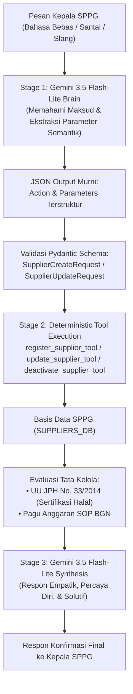

# Arsitektur AI-Native Autonomous CRUD Rekanan (ResilioAI)

## 1. Konsep & Filosofi
Sebelumnya, sistem masih menggunakan pola hibrida di mana niat diputuskan oleh AI, namun atribut di dalam fungsi pendaftaran dan pembaruan masih diurai ulang (*parsing*) menggunakan ekspresi reguler (regex).

**Masalah Pola Hibrida:**
- Jika pengguna menulis instruksi santai seperti:
  > *"tolong supplier baru CV Barokah Tahu, komoditas daging tahu, harga Rp 38.000, kapasitas 200 kg, halal ID3211"*
  Regex nama dan atribut berisiko gagal mencocokkan kata jika pengguna tidak menggunakan awalan kata kerja baku (`daftarkan`/`tambahkan`).

**Solusi AI-Native CRUD (Standar Industri 2026):**
Menyerahkan pemahaman instruksi, konteks, dan ekstraksi parameter sepenuhnya kepada **Gemini 3.5 Flash-Lite Brain**. Model AI secara sadar mengetahui bahwa ia memiliki *tools* CRUD penuh:
1. **Create (`REGISTER_SUPPLIER`)**
2. **Read / List (`LIST_SUPPLIERS`) & Read Detail (`GET_SUPPLIER_DETAIL`)**
3. **Update (`UPDATE_SUPPLIER`)**
4. **Delete / Deactivate (`DEACTIVATE_SUPPLIER`)**

---

## 2. Alur Eksekusi Zero-Regex



---

## 3. Spesifikasi Kontrak Parameter Semantik

### A. Pendaftaran Baru (`REGISTER_SUPPLIER`)
Model AI mengekstrak:
```json
{
  "action": "REGISTER_SUPPLIER",
  "parameters": {
    "supplier_name": "CV Barokah Tahu",
    "commodity": "DAGING_TAHU",
    "category": "PROTEIN",
    "unit_price_idr": 38000,
    "daily_capacity_kg": 200,
    "halal_certified": true,
    "halal_cert_number": "ID3211",
    "lead_time_hours": 3.0,
    "distance_km": 15.0
  }
}
```
Jika `supplier_name`, `unit_price_idr`, atau `daily_capacity_kg` bernilai `null` (karena pengguna hanya berkata *"saya mau daftar rekanan baru"*), AI otomatis menandainya dan agen secara cerdas menanyakan informasi yang belum lengkap.

### B. Pembaruan Data (`UPDATE_SUPPLIER`)
Model AI mengekstrak:
```json
{
  "action": "UPDATE_SUPPLIER",
  "parameters": {
    "supplier_name_or_id": "PT Berkah Unggas Jaya",
    "unit_price_idr": 36500,
    "daily_capacity_kg": null,
    "lead_time_hours": null
  }
}
```

### C. Penonaktifan Rekanan (`DEACTIVATE_SUPPLIER`)
Model AI mengekstrak:
```json
{
  "action": "DEACTIVATE_SUPPLIER",
  "parameters": {
    "supplier_name_or_id": "UD Ayam Murah Meriah",
    "reason": "Sering terlambat dan tidak memenuhi standar mutu"
  }
}
```

---

## 4. Keuntungan Arsitektur Ini
1. **Zero Regex Maintenance**: Tidak ada lagi ratusan baris pola regex rapuh. AI bebas diajak bicara dengan bahasa apa pun.
2. **AI Awareness**: AI paham bahwa ia memiliki otoritas dan kapabilitas untuk mengeksekusi CRUD di sistem SPPG.
3. **Zero Hallucination**: AI hanya mengekstrak niat dan parameter. Mutasi data dan kalkulasi tata kelola tetap dieksekusi 100% deterministik di Python.

