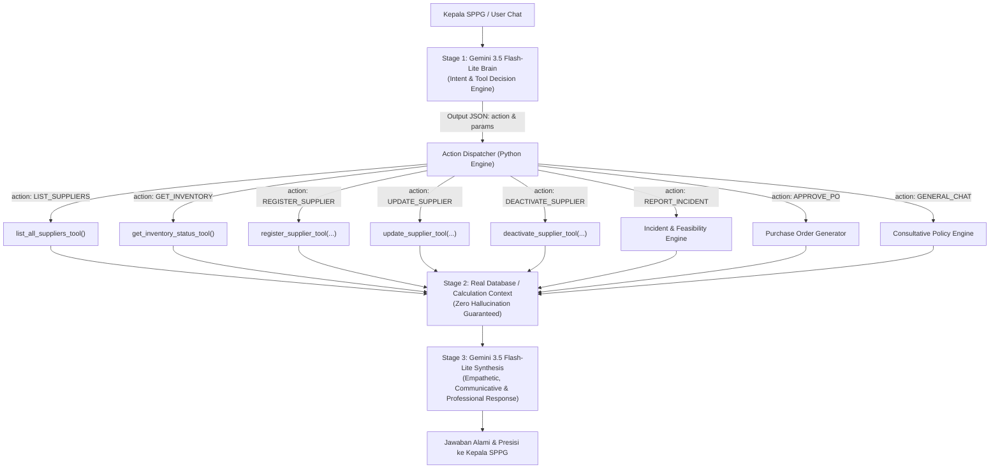

# Rencana Arsitektur: LLM Cognitive Tool Dispatcher (ResilioAI Agent)

## 1. Latar Belakang & Urgensi
Sistem sebelumnya masih mengandalkan aturan pencocokan kata kunci/regex (*keyword-based routing*) untuk mendeteksi apakah pesan pengguna merupakan pertanyaan daftar supplier, cek inventaris, atau pendaftaran rekanan. 

**Kelemahan Pola Lama:**
- **Rapuh (*Brittle*):** Pertanyaan wajar seperti *"suplier kita saat ini ada apa aja"* gagal dikenali karena tidak cocok dengan pola kaku `["daftar", "berapa", "lihat"] + ["suplier"]`.
- **Halusinasi:** Saat salah rute ke obrolan bebas, model LLM Gemini tanpa sengaja mengarang data rekanan fiktif (*PT Tani Makmur*, *RPH Berkah Mandiri*, dll.) karena tidak dibekali data database riil.

**Solusi Standar Industri (2026 AI Agent Best Practice):**
Mengadopsi pola **Autonomous Cognitive Agent (Two-Stage Action Loop)** di mana Gemini 3.5 Flash-Lite bertindak sebagai *Brain* yang memahami konteks percakapan bebas dan secara otonom menentukan tool yang harus dipanggil berserta parameternya.

---

## 2. Diagram Alur Arsitektur (Two-Stage Cognitive Loop)

---

## 3. Rincian Aksi & Tool Mapping

| Aksi LLM (`action`) | Contoh Masukan Bebas Kepala SPPG | Fungsi Tool Deterministik (Python) |
| :--- | :--- | :--- |
| `LIST_SUPPLIERS` | *"suplier kita saat ini ada apa aja"*, *"siapa aja vendor daging ayam?"*, *"spill rekanan aktif"* | `list_all_suppliers_tool(commodity=...)` |
| `GET_INVENTORY` | *"gudang beras kita sisa berapa?"*, *"cek kapasitas freezer"*, *"stok ayam cukup gak?"* | `get_inventory_status_tool(item_id=...)` |
| `REGISTER_SUPPLIER` | *"daftarkan supplier baru CV Berkah Mandiri harga 38rb kapasitas 200kg halal"* | `register_supplier_tool(payload)` |
| `UPDATE_SUPPLIER` | *"update harga PT Berkah Unggas Jaya jadi 36500"* | `update_supplier_tool(supplier_id, updates)` |
| `DEACTIVATE_SUPPLIER` | *"nonaktifkan supplier UD Ayam Murah Meriah"* | `deactivate_supplier_tool(supplier_id, reason)` |
| `REPORT_INCIDENT` | *"gudang supplier utama kita kebakaran nih mas"*, *"ada banjir pengiriman terhambat"* | Mitigasi Insiden & Feasibility Engine |
| `APPROVE_PO` | *"oke saya setuju buatkan PO nya"*, *"deal lanjutkan proses"* | Penerbitan PO Resmi SPPG |
| `GENERAL_CHAT` | *"halo selamat pagi"*, *"bagaimana SOP sertifikasi halal UU 33/2014?"* | Konsultasi Kebijakan & Regulasi SPPG |

---

## 4. Rencana Langkah Kerja Implementasi

### Langkah 1: Bangun Decision Router di `ConversationalAgentManager`
- Menambahkan metode `_decide_action_with_llm(user_message, history) -> Dict[str, Any]` yang meminta Gemini mengembalikan JSON murni:
  `{"action": "...", "params": { ... }}`.
- Mendukung *Graceful Fallback*: jika API eksternal offline, sistem memiliki fallback deterministik yang aman sehingga service tidak pernah *crash*.

### Langkah 2: Refactor `process_message` Menjadi Dispatcher Bersih
- Menghapus tumpukan regex triggers (`supplier_manage_triggers`, `inventory_inquiry_triggers`, `supplier_inquiry_triggers`).
- Mengarahkan alur pesan ke `action` yang dihasilkan oleh Gemini Brain.
- Menjalankan tool Python deterministik yang sudah ada di [`app/engine/tools.py`](file:///d:/coding/Risilio%20Ai/app/engine/tools.py) (*Zero duplicate functions*).

### Langkah 3: Verifikasi Menyeluruh & Testing
- Menjalankan seluruh test suite otomatis `tests/test_api.py`, `tests/test_tools.py`, dll. (memastikan 24/24 tests tetap `OK`).
- Menguji skenario bahasa percakapan nyata via simulator:
  1. *"suplier kita saat ini ada apa aja"* -> Mengambil data riil dari `mock_db.py`.
  2. *"gudang beras sisa berapa kilo?"* -> Mengambil data fisik gudang riil.
  3. *"tolong daftarkan rekanan PT Sinar Protein harga 39000 kapasitas 180kg halal"* -> Otomatis mendaftarkan rekanan baru.
- Memperbarui riwayat Relay.

